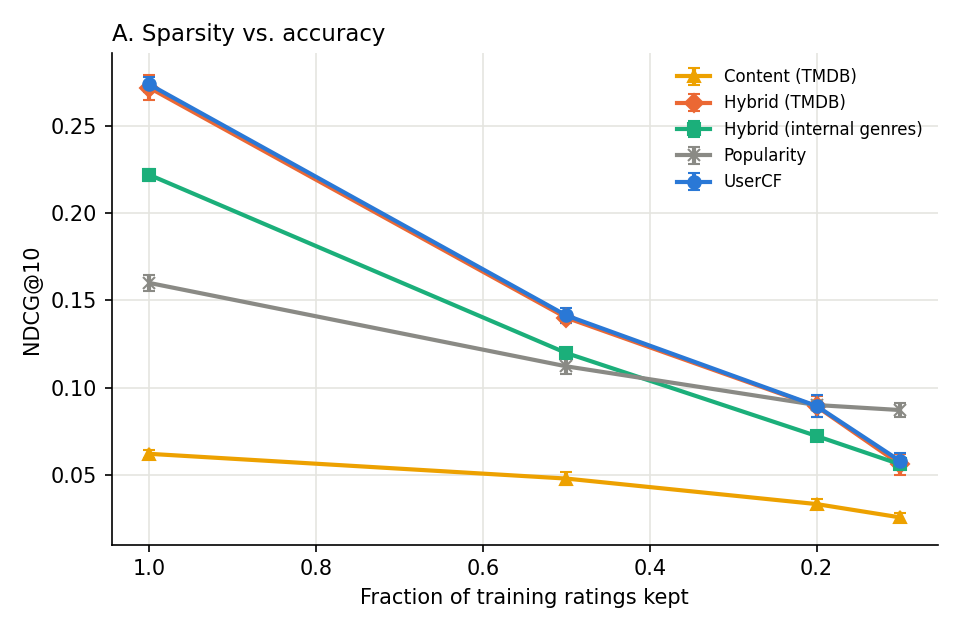

# multisource-recsys

**Can external data collected from an API make user-based collaborative filtering more robust when ratings are sparse?**

A small study project that combines two things I have worked on: a user-based collaborative filtering (UserCF) recommender from my undergraduate thesis, and data collection pipelines from my work as an RPA engineer.

## Motivation

In my undergraduate thesis I built a UserCF recommender for a video-sharing platform. I found that when users have rated only a few items, it becomes hard to find similar users, and the recommendation quality drops sharply.

At my job, I built pipelines that collected and integrated data from multiple websites and systems. This led to a simple idea: **if the rating data alone is not enough, can information collected from outside help fill the gap?**

## Research questions

- **RQ1**: Does adding external metadata (from TMDB) to the user similarity improve accuracy when ratings are sparse?
- **RQ2**: If part of the external data is missing (e.g. because collection failed), how much does accuracy drop? Does filling the gap with internal genre data help?
- **RQ3**: How should rating similarity and metadata-based similarity be weighted?

## Pipeline

```
TMDB API ──collect──> cache (JSONL) ──clean & quality check──> tmdb_metadata.csv
                                                                     │
MovieLens (ratings, genres) ─────────────────────────────────────────┤
                                                                     ▼
                                                     item feature vectors (TF-IDF)
                                                                     │
               rating similarity + taste-profile similarity ──> HybridUserCF ──> evaluation
```

### 1. Data collection (`msrec/collect_tmdb.py`)

Using the TMDB IDs in MovieLens `links.csv`, the collector fetches each movie's genres, directors, top-5 cast, keywords and release year through the official TMDB API.
It handles the problems I often met in long-running collection jobs at work:

| Problem | How it is handled |
|---|---|
| The job stops halfway (network loss, PC shutdown) | Each result is appended to a JSONL cache; rerunning fetches only what is missing |
| Rate limiting (HTTP 429) | Waits for the time given in the `Retry-After` header |
| Temporary server errors (5xx) | Retries with exponential backoff, then records the item as failed |
| Missing or unexpected fields | Treated as empty values; one bad response never stops the whole job |
| Not knowing how complete the data is | Writes `collection_report.json` with coverage and per-field missing rates |

### 2. Recommenders (`msrec/models.py`)

| Method | Description |
|---|---|
| Popularity | Most-rated movies first (a simple lower bound) |
| UserCF | Cosine similarity of rating vectors, top-k neighbors (re-implementation of my thesis method) |
| ContentBased | Similarity between a user's taste profile and movie features |
| **HybridUserCF** | User similarity computed from both ratings and external metadata |

User similarity in HybridUserCF:

$$
\mathrm{sim}(u, v) = \lambda \cdot \cos(\mathbf{r}_u, \mathbf{r}_v) + (1 - \lambda) \cdot \cos(\mathbf{p}_u, \mathbf{p}_v)
$$

- $\mathbf{r}_u$: the rating vector of user $u$
- $\mathbf{p}_u$: the taste profile of user $u$ — the TF-IDF feature vectors of the movies the user rated, weighted by (rating − the user's mean rating)

The idea: even if two users have no movies in common, they can still be found similar if they both like movies by the same director or with the same keywords.

### 3. Evaluation (`msrec/metrics.py`, `msrec/experiment.py`)

- For each user, 20% of the ratings are held out as the test set; test items rated ≥ 4.0 count as relevant
- Metrics: Precision@10, Recall@10, **NDCG@10**, catalog coverage
- Repeated with 3 random seeds; mean ± standard deviation reported
- λ is fixed to 0.5 in advance for experiments A and B (not tuned on the test set); experiment C shows the effect of λ

| Experiment | Setting |
|---|---|
| A. Sparsity | Keep 100% / 50% / 20% / 10% of the training ratings |
| B. Missing data | With 20% of training ratings, remove 0% / 30% / 60% / 90% of the TMDB metadata, with and without filling the gaps with MovieLens genres |
| C. λ | With 20% of training ratings, λ = 0, 0.25, 0.5, 0.75, 1 |

## Results

Dataset: MovieLens ml-latest-small (610 users, ~9,700 movies, ~100k ratings).
TMDB metadata was collected for **XX%** of the movies (the collection was stopped early, so many movies have no external data).
Full tables and figures: [`results/results.md`](results/results.md).

**Experiment A — NDCG@10 by fraction of training ratings kept**

| Method | 100% | 50% | 20% | 10% |
|---|---|---|---|---|
| Popularity | 0.1601 ± 0.0044 | 0.1119 ± 0.0046 | **0.0900 ± 0.0020** | **0.0880 ± 0.0040** |
| UserCF | **0.2738 ± 0.0045** | **0.1414 ± 0.0042** | 0.0895 ± 0.0062 | 0.0580 ± 0.0043 |
| Hybrid (internal genres) | 0.2220 ± 0.0034 | 0.1198 ± 0.0003 | 0.0723 ± 0.0011 | 0.0560 ± 0.0031 |
| Hybrid (TMDB) | 0.2671 ± 0.0028 | 0.1367 ± 0.0008 | 0.0836 ± 0.0029 | 0.0536 ± 0.0044 |
| Content (TMDB) | 0.0569 ± 0.0015 | 0.0400 ± 0.0011 | 0.0266 ± 0.0021 | 0.0202 ± 0.0009 |



### Findings

1. **HybridUserCF did not beat plain UserCF** at any sparsity level, so RQ1 is not supported in this setting. TMDB metadata was clearly better than MovieLens genres alone (0.2671 vs 0.2220 with all ratings), but still slightly below UserCF.
2. **λ explains much of this.** In experiment C, accuracy rose steadily as λ increased: 0.0706 (λ = 0), 0.0800 (λ = 0.25), 0.0836 (λ = 0.5), and λ = 1 is identical to UserCF (0.0895). The metadata-based similarity was hurting rather than helping.
3. **Likely cause: the two similarities are on different scales.** With sparse ratings, rating cosine similarities are small (around 0.1–0.3), while taste-profile similarities are large (around 0.5–0.9), because most users like broad categories such as Drama or Comedy. So even with λ = 0.5, the profile side dominates the choice of neighbors.
4. **Missing metadata (experiment B) changed accuracy only a little**, and filling the gaps with genres did not help (e.g. 0.0836 → 0.0808 when 30% was removed without fallback; 0.0798 → 0.0765 with fallback). This is consistent with point 2: the external data had little positive effect to begin with.
5. **Popularity was the best method at 20% and 10%.** This is a known bias of offline evaluation: popular movies are more likely to appear in the held-out test set.

### Limitations and next steps

- Normalize the two similarities to a common scale (e.g. per-user ranks) before combining them, and choose λ on a validation set
- Collect TMDB metadata for all movies and rerun
- ml-latest-small is not very sparse (every user has at least 20 ratings); test on a sparser dataset
- Missing data is removed at random here, but real collection failures are biased (older and less popular movies fail more often)
- Offline evaluation favors popular items and does not measure real user satisfaction

## How to run

Python 3.8 or later.

```bash
pip install -r requirements.txt

# 1. Download MovieLens ml-latest-small and put ratings.csv, movies.csv, links.csv in data/raw/
#    https://grouplens.org/datasets/movielens/latest/

# 2. Get a TMDB API key (https://www.themoviedb.org/settings/api) and set it
export TMDB_API_KEY=xxxxxxxx            # Windows PowerShell: $env:TMDB_API_KEY="xxxxxxxx"

# 3. Collect metadata (~9,700 movies; safe to stop and rerun)
python -m msrec.collect_tmdb --raw data/raw --out data/external
#    After stopping early, rebuild the CSV and report from the cache only:
python -m msrec.collect_tmdb --raw data/raw --out data/external --limit 0

# 4. Run the experiments (outputs go to results/)
python -m msrec.experiment --raw data/raw --tmdb data/external/tmdb_metadata.csv --out results

# Tests (no API access needed)
python -m pytest tests
```

Without an API key, you can check the whole pipeline on synthetic data (the numbers are not research results):

```bash
python scripts/make_synthetic_data.py --out data/synthetic
python -m msrec.experiment --raw data/synthetic/raw \
    --tmdb data/synthetic/external/tmdb_metadata.csv --out results_synthetic
```

## Project structure

```
msrec/
  data.py           loading, train/test split, sparsification
  collect_tmdb.py   TMDB collection (cache, retries, quality report)
  features.py       item features (TF-IDF), simulated missing data and fallback
  models.py         Popularity / UserCF / ContentBased / HybridUserCF
  metrics.py        Precision / Recall / NDCG / coverage
  experiment.py     experiments A, B, C, tables and figures
scripts/make_synthetic_data.py   synthetic data for testing the pipeline
tests/                           unit tests
```

## Data and license

- MovieLens: F. Maxwell Harper and Joseph A. Konstan. 2015. The MovieLens Datasets: History and Context. ACM TiiS 5, 4. The data is not included in this repository, following the GroupLens terms of use.
- This product uses the TMDB API but is not endorsed or certified by TMDB. Collected TMDB data is not included in this repository.

## Author

Chen Yongfang — [GitHub](https://github.com/chenyongfang6657-sudo)
