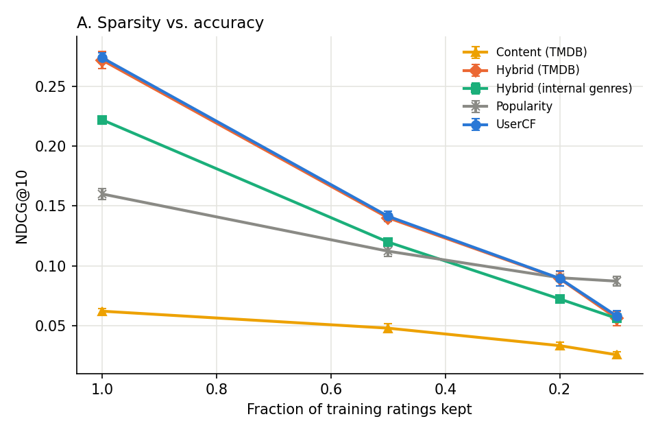
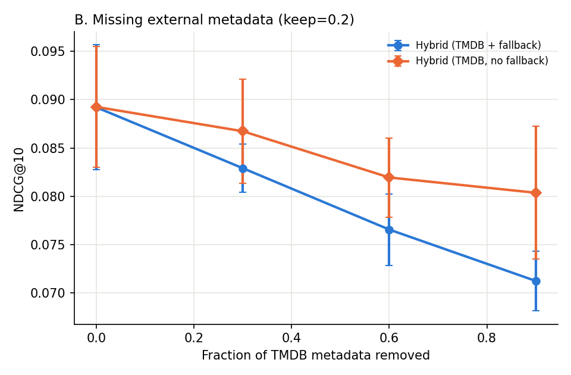
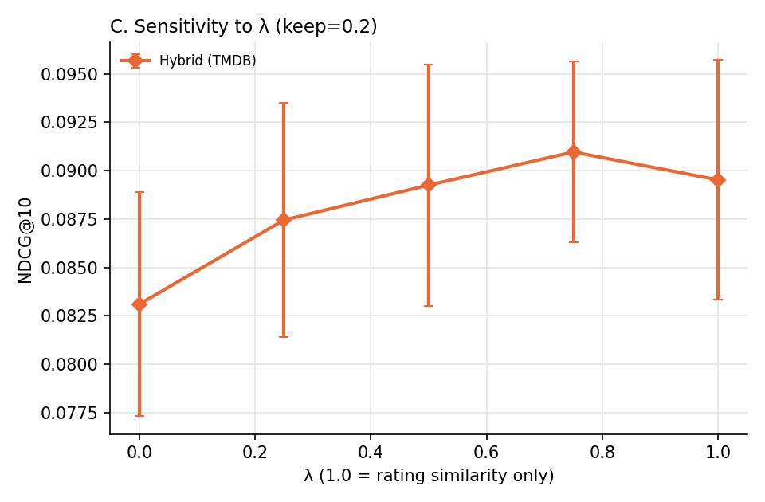

# Results

Metric: NDCG@10 (mean ± std over 3 seeds)

Movies with TMDB metadata: 98.8%

## Experiment A: rating sparsity

| method                   | 1.0             | 0.5             | 0.2             | 0.1             |
|:-------------------------|:----------------|:----------------|:----------------|:----------------|
| Content (TMDB)           | 0.0621 ± 0.0023 | 0.0479 ± 0.0038 | 0.0333 ± 0.0029 | 0.0257 ± 0.0028 |
| Hybrid (TMDB)            | 0.2719 ± 0.0071 | 0.1401 ± 0.0032 | 0.0893 ± 0.0062 | 0.0561 ± 0.0059 |
| Hybrid (internal genres) | 0.2220 ± 0.0034 | 0.1198 ± 0.0003 | 0.0723 ± 0.0011 | 0.0561 ± 0.0031 |
| Popularity               | 0.1600 ± 0.0045 | 0.1122 ± 0.0045 | 0.0901 ± 0.0019 | 0.0872 ± 0.0038 |
| UserCF                   | 0.2738 ± 0.0045 | 0.1414 ± 0.0042 | 0.0895 ± 0.0062 | 0.0580 ± 0.0043 |

## Experiment B: missing external metadata (20% of training ratings)

| method                     | 0.0             | 0.3             | 0.6             | 0.9             |
|:---------------------------|:----------------|:----------------|:----------------|:----------------|
| Hybrid (TMDB + fallback)   | 0.0892 ± 0.0065 | 0.0829 ± 0.0025 | 0.0766 ± 0.0037 | 0.0713 ± 0.0031 |
| Hybrid (TMDB, no fallback) | 0.0893 ± 0.0062 | 0.0867 ± 0.0054 | 0.0820 ± 0.0041 | 0.0804 ± 0.0069 |

## Experiment C: sensitivity to λ (20% of training ratings)

| method        | 0.0             | 0.25            | 0.5             | 0.75            | 1.0             |
|:--------------|:----------------|:----------------|:----------------|:----------------|:----------------|
| Hybrid (TMDB) | 0.0831 ± 0.0058 | 0.0874 ± 0.0061 | 0.0893 ± 0.0062 | 0.0910 ± 0.0047 | 0.0895 ± 0.0062 |

